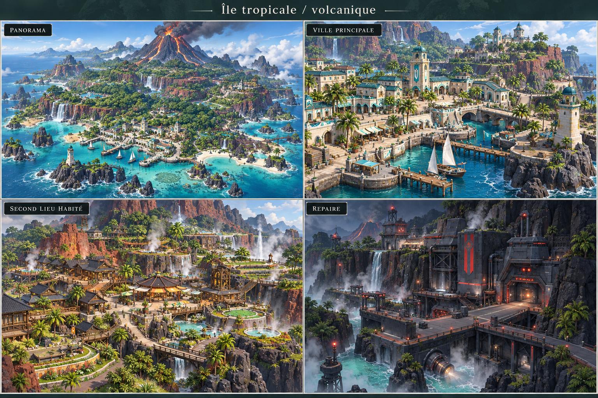
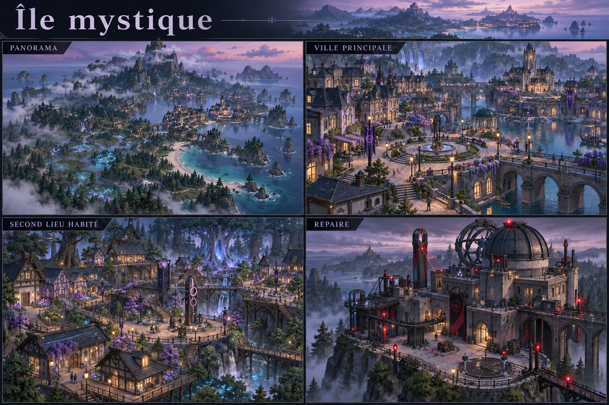
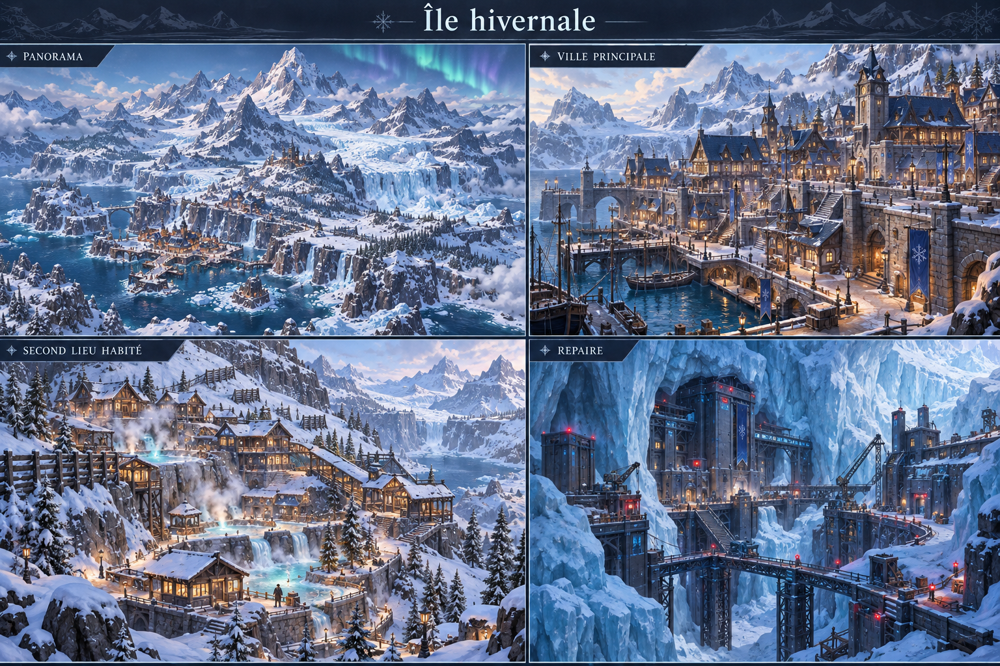
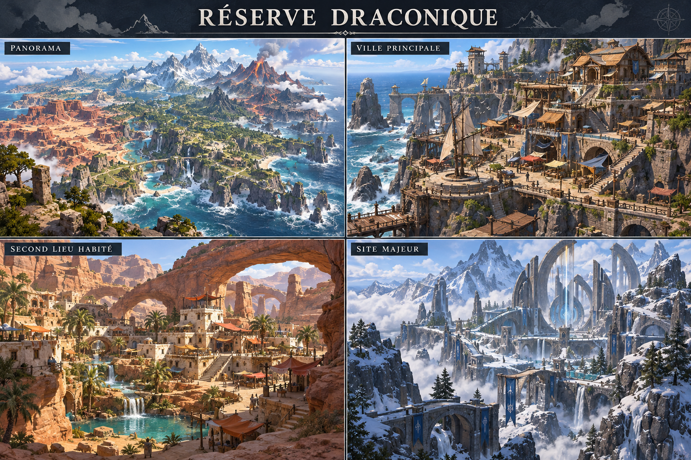
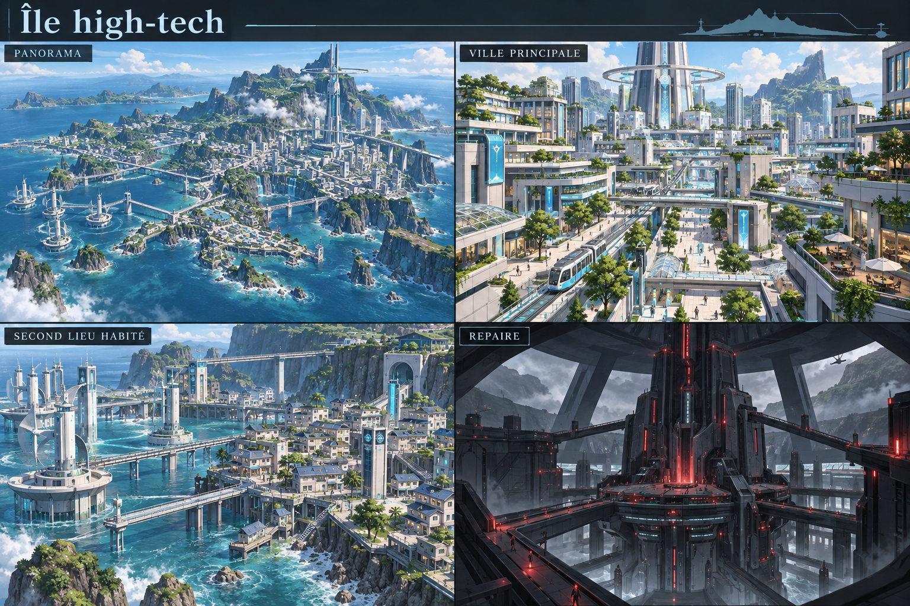
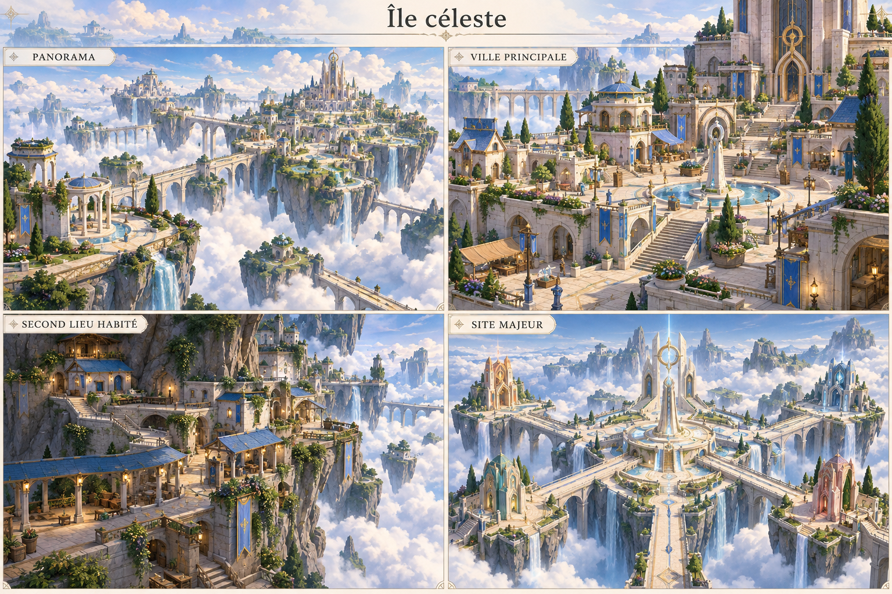
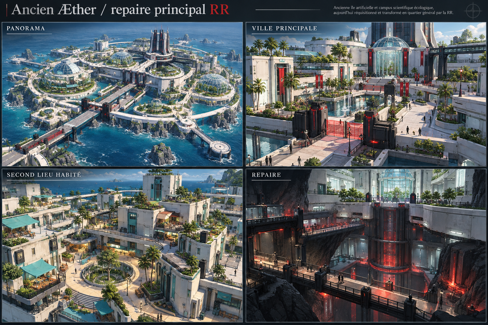

# Archélys — atlas graphique proposé, 12 octobre 2026

SPOILERS DEV. Sept planches générées dans le chat à la demande du propriétaire (D67), puis explicitement approuvées comme direction artistique (D68). Chaque planche présente quatre vues, dans l'ordre : panorama, premier lieu habité, second lieu habité, repère majeur. **Ce sont des propositions de direction artistique, pas des captures du jeu, des plans de villes complets ou des meshes prêts à importer.** Les deux lieux habités ne limitent pas le nombre final de villes. Noms ci-dessous descriptifs et provisoires.

| Région | Premier lieu habité | Second lieu habité | Repère majeur |
|---|---|---|---|
| Tropicale/volcanique | Port à arcades, maisons crème, toits turquoise, promenades ombragées | Village de basalte et jardins géothermiques | Raffinerie géothermique RR intégrée aux falaises |
| Mystique | Ville des ponts sur un lac brumeux | Village des lanternes dans la forêt | Observatoire et archives occupés RR |
| Hivernale | Port nordique en pierre et bois | Village des sources chaudes à flanc de montagne | Station minière RR dans le glacier |
| Réserve draconique | Village des falaises et abris contre le vent | Oasis sous des arches naturelles | Portes des biomes sacrés, sans occupation RR |
| High-tech | Métropole des terrasses, jardins et tram | Quartier marémoteur et logements | Tour de contrôle énergétique RR |
| Céleste | Ville sanctuaire autour de jardins | Refuge au-dessus des nuages | Quatre portes autour d'un cinquième sanctuaire central, sans RR |
| Ancien Æther | Campus scientifique saisi | Quartier des chercheurs et logements | Commandement et prison RR sous l'architecture initiale |

L'ordre principal demandé reste tropicale → mystique → hivernale → high-tech, avec retours draconiques progressifs. L'ordre d'affichage de l'atlas n'est pas un ordre de progression. L'île céleste et le repaire Æther restent les étapes de fin envisagées, pas des chapitres jouables ajoutés par ce lot.

## Tropicale

## Mystique

## Hivernale

## Draconique

## Hightech

## Celeste

## Aether

## Passer du concept au jeu

L'atlas du laboratoire ouvre28 maquettes de volumes indépendantes de la campagne. Rotation et zoom servent à juger l'échelle générale ; aucune mission, visite, acquisition ou progression n'est enregistrée. Les maquettes utilisent des formes procédurales simples et partagent des modules. Elles ne reproduisent pas la richesse des illustrations, ni leurs plans exacts. Les quartiers complets, chemins continus, intérieurs et collisions des autres îles restent à construire.

Après choix artistique : extraire un kit modulaire d'une seule ville (murs, toits, ouvertures, sol, végétation, eau), préparer sources/UV/LOD/collisions, puis importer dans la première île jouable. Vérifier les raccords et silhouettes aux distances de caméra retenues avant multiplication sur les autres lieux. Les Pokémon, personnages, rigs et animations définitifs suivent leur pipeline propre.

## Provenance

Illustrations originales générées avec l'outil image_gen.imagegen pour cette demande, sans extraction de jeux ni utilisation de fichiers artistiques externes dans la génération. PNG copiés sans modification ; empreintes/source dans concepts/provenance.json, briefs dans CONCEPT_PROMPTS_2026-10-12.json. Distribution ici comme documents de travail, sans présumer d'exclusivité ou de droits sur l'univers Pokémon. Elles n'ajoutent aucune licence aux modèles officiels éventuels. Les sept planches sont approuvées en D68 ; le rendu des meshes intégrés reste à valider en jeu.
