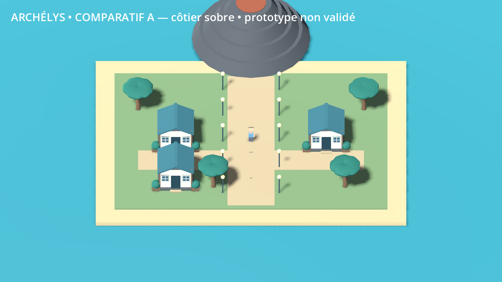
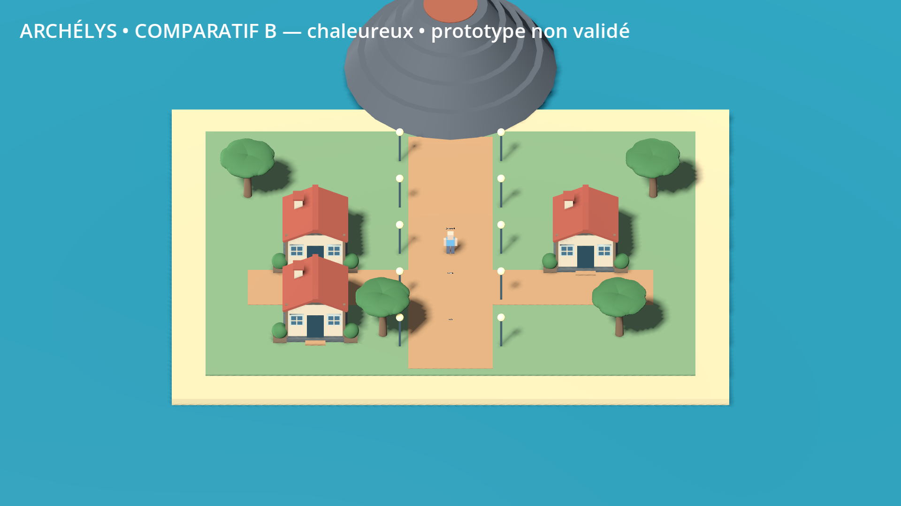
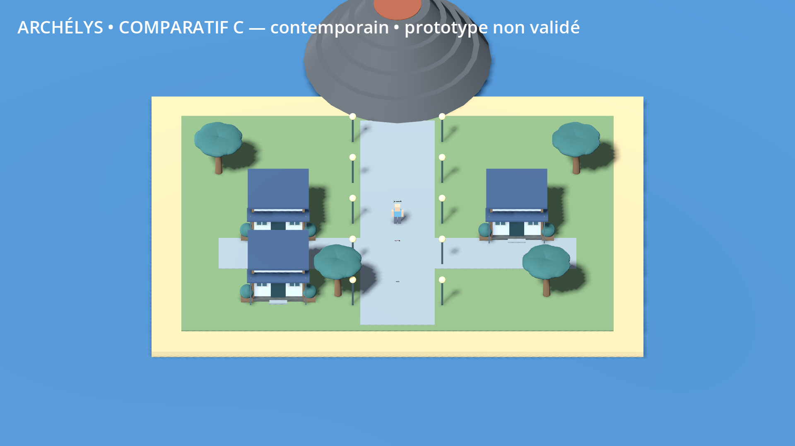

# Quartier — trois directions à comparer

**Prototype original, non validé.** N45 demande des images avant adoption des assets. Le village de tests conserve son décor existant ; les trois alternatives restent dans un lieu séparé nommé `district`. Entrer par le passage nord du village, puis E/Entrée près du point `visuals` pour passer de A à B puis C. Aucune direction n'est appliquée aux îles de production.

Les captures viennent du moteur, en **1920 × 1080**, avec le même placement des bâtiments, la même caméra et le même éclairage. Ce sont des géométries de laboratoire : ni illustration contractuelle du jeu final ni quartier terminé.

## A — côtier sobre

Façades claires, toiture à deux pans bleu pétrole, végétation douce et chemin sable. Base lisible pour un village côtier.

## B — chaleureux

Toiture terre cuite, cheminée et palette plus chaude. Direction rurale et accueillante avant les zones volcaniques.

## C — contemporain

Toit plat, auvent avec poteaux fins, chemins plus froids. Direction plus moderne, pouvant servir aux bourgs proches de l'île high-tech.

Le module contient socle, marches, encadrements, fenêtres, toiture, jardinières, arbres, éclairages et relief volcanique. Feuillage et surface d'eau ont une animation légère ; l'eau reste une surface unie, pas un shader final de vagues/reflets. Les intérieurs Centre/boutique sont des essais de circulation et services ; leur art attend également validation. Le mannequin animé antérieur est conservé. Les ombres et matériaux demandent une passe artistique après le choix, notamment la silhouette du volcan et les raccords de sol ; produire les assets des îles maintenant serait prématuré.

Retour utile après le test regroupé : choisir A/B/C/aucune, puis indiquer ce qui convient pour bâtiments, végétation, eau et sol séparément. Un choix global ne vaut pas approbation automatique de chaque objet. Les paramètres graphiques en jeu restent ceux du laboratoire, pas un engagement de 60 FPS sur une configuration minimale ; les captures ont été rendues sur Mesa llvmpipe, sans GPU représentatif du PC Windows.

Provenance : géométrie, palettes et animation écrites dans `game/scripts/world/visual_district.gd` ; captures générées depuis ce code. Aucun asset commercial, modèle Nintendo ou texture externe. La licence générale du code original demeure à décider selon N50 ; aucune autorisation graphique Nintendo n'est déduite de la licence PokéAPI.
