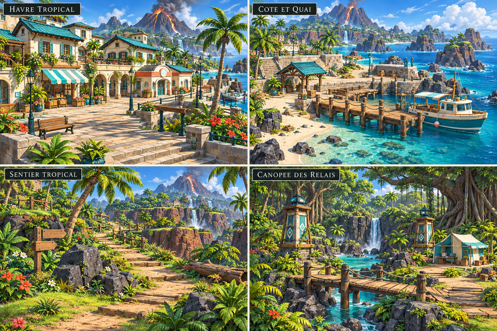
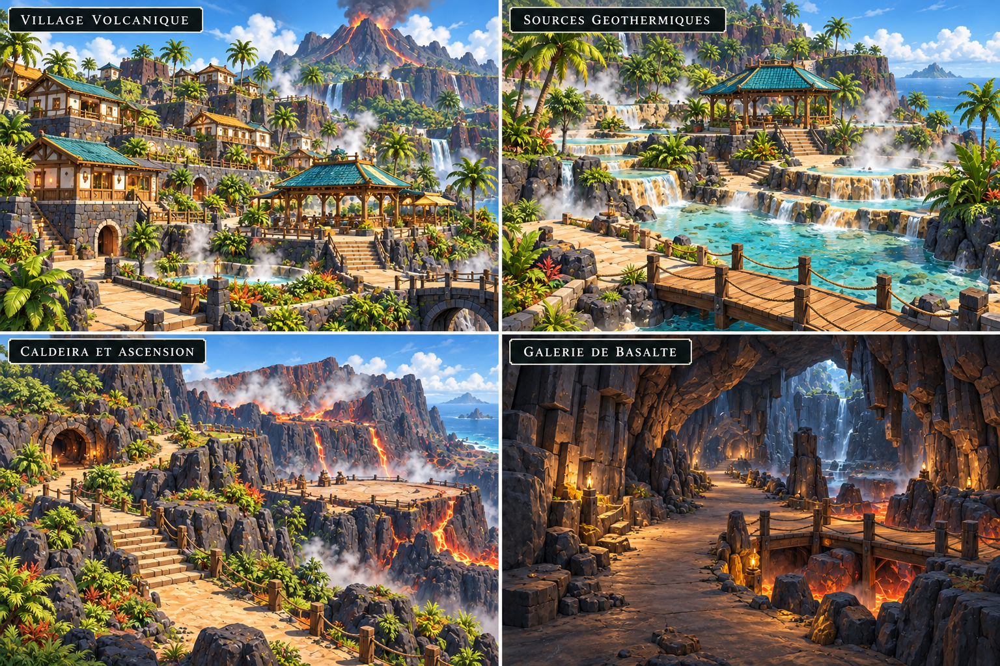
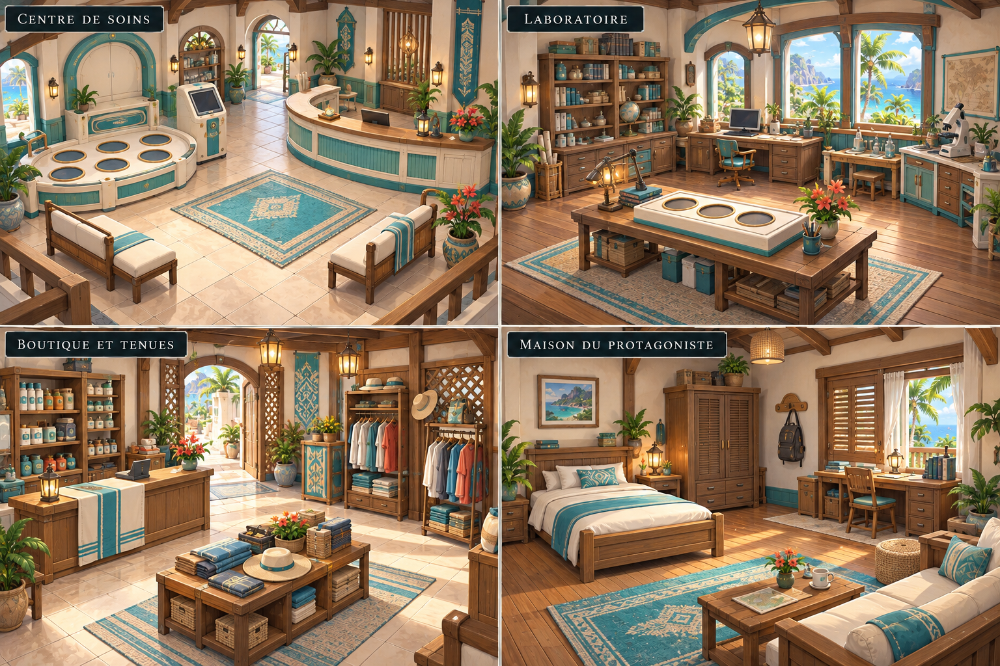
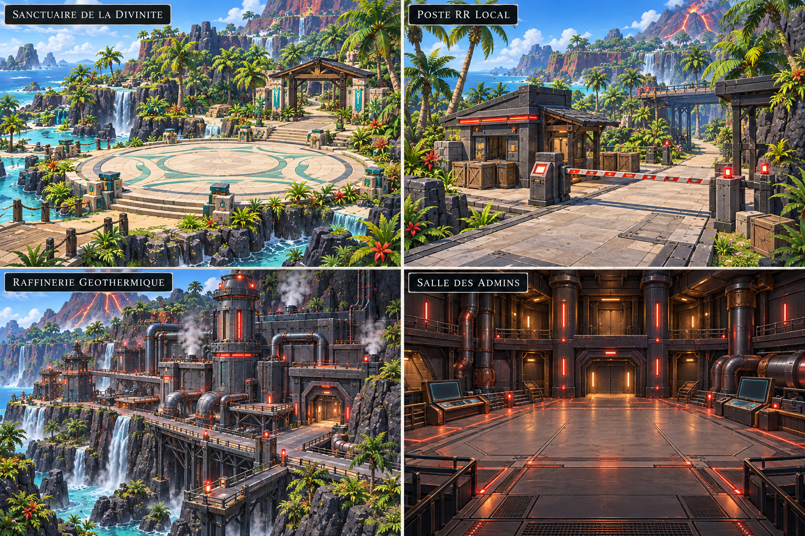

# Archélys — références de production de la première île

SPOILERS DEV. Quatre planches, seize vues. Illustrations de référence générées à la demande du propriétaire ; pas captures de Godot, modèles 3D ou plans jouables finalisés. Concepts détaillés à adapter aux contraintes du jeu. Le rendu intégré reste à démontrer et à valider.

Chaque planche se lit : haut gauche → haut droite → bas gauche → bas droite.

| Planche | Vues et usages |
|---|---|
| 01 | Havre tropical ; côte/quai ; sentier ; canopée/relais/camp |
| 02 | Village volcanique ; sources et championne humaine ; caldeira/ascension ; galerie de basalte |
| 03 | Centre de soins ; laboratoire/starter ; boutique/vêtements ; maison du protagoniste |
| 04 | Sanctuaire de la divinité locale ; poste RR local ; raffinerie secondaire ; salle des admins |

## Comment les utiliser avec le catalogue

Le fichier [Prompts-assets-premiere-ile-Archelys.xlsx](../Prompts-assets-premiere-ile-Archelys.xlsx) contient les prompts par asset. Choisir d'abord la zone, puis l'objet à fabriquer : une boutique, une maison, un palmier, un comptoir, un rocher, etc. Les planches donnent palette, matériaux et silhouettes ; tous leurs petits ornements ne sont pas une obligation de production.

Pour **texte/image vers image**, associer le prompt de l'asset à la planche comme référence artistique et demander UNE vue de l'objet isolé sur fond neutre, complet et sans socle/sol/voisins/personnages. Cet objet isolé devient la référence **image vers 3D**. Ne pas envoyer une planche complète à quatre vues à la reconstruction 3D : risque de scène ou d'objets fusionnés. Un recadrage seul peut garder ombres et contexte ; vérifier la référence isolée avant de consommer les crédits 3D.

Suffixe commun possible pour la phase de référence individuelle :

> Use the supplied board only as art-direction reference. Depict ONE complete isolated asset described in the prompt, centered on a plain neutral background, three-quarter view, coherent proportions and materials. No scene, ground slab, pedestal, other objects, characters, labels, or cast shadow. Do not reproduce all four board panels. Keep details readable at a medium-distance game camera.

Pour les objets simples, garder la bibliothèque modulaire plutôt que générer chaque variante. Ne pas générer une ville, une forêt ou une grotte entière en un modèle. Eau, lave, vapeur, écrans et lumière sont des effets/matériaux séparés, non des objets fusionnés au mesh. Les ombres de ces illustrations ne doivent pas être peintes dans les textures des modèles.

## Familles du catalogue à utiliser

| Zones | Familles à filtrer dans Excel |
|---|---|
| Havre/quai | Boutique, maison commune, Centre, laboratoire, arcade, quai/bateau, lampadaire, banc, palmier |
| Sentier/canopée | Arbres, arbustes, herbes, fougères, racines, rochers, pont, relais, tente et panneaux |
| Village/sources | Maison volcanique, pavillon, terrasse géothermique, passerelle, escaliers et mur basalte |
| Caldeira/galerie | Falaises, entrée/parois/piliers de grotte, plateformes et rochers ; lave séparée |
| Intérieurs | Comptoirs, station de soins, terminal PC, bureau, plateau des starters, étagères, lit et mobilier |
| Sanctuaire/RR | Portique, autel/plateforme, poste, barrières, raffinerie, conduites, machines et consoles |

Le personnage n'est pas redessiné dans ces planches : préserver l'essai d'avatar apprécié, puis éprouver son export/rig avant les déclinaisons. Aucune espèce de starter ou divinité n'est choisie ici. Le sanctuaire local n'introduit pas les Gardiens célestes ; la raffinerie n'est pas le repaire principal Æther. Le poste local est une étape distincte de la fin d'île.

## Priorité de génération

Boutique pilote → un avatar exporté/animé → maison et Centre → quelques végétaux/accessoires → portion de rue testée. Produire les familles suivantes seulement après import réussi et appréciation du rendu. Les seize vues couvrent le projet d'île ; elles ne demandent pas seize grandes scènes 3D ni 181 générations.

## Conservation

Les quatre PNG originaux sont copiés sans modification ; outil, référence, dimensions et SHA256 dans `provenance.json`. Les fichiers source générés restent conservés. Aucun asset Meshy/Tripo généré ou intégré dans cette livraison, aucun changement du jeu ou des sauvegardes.
