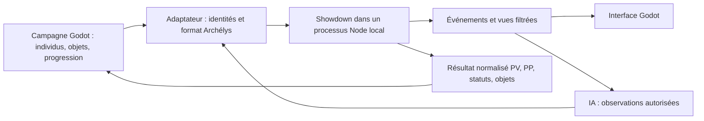

# Étude du moteur de combat — 11 octobre 2026

**Recommandation technique : conserver Godot pour le jeu et utiliser Pokémon Showdown pour résoudre les combats.** Tactica peut servir de référence pour les règles et les données de conception. Porter son moteur GBA complet serait beaucoup plus coûteux. Cette étude ne remplace pas le moteur actuel et ne modifie aucune sauvegarde ni livraison Windows.

## Licence : utilisation autorisée, sous conditions

[Showdown est sous MIT](https://github.com/smogon/pokemon-showdown/blob/942cda71d14bf0618bd57991708a2e2734b6daba/LICENSE). Utilisation, modification et redistribution sont permises, même dans un logiciel propriétaire. Il faut conserver sa notice de copyright et le texte intégral de sa licence dans les copies ou parties substantielles distribuées. Aucune obligation de publier notre code original. La clause d'absence de garantie fait partie du texte à conserver.

Cette permission concerne le code couvert par la licence ; elle ne donne aucun droit supplémentaire sur les marques, modèles, sprites ou musiques Pokémon. Les dépendances et le runtime Node devront aussi avoir leurs notices dans la distribution. La licence du code original Archélys reste un choix distinct (N50).

Aucun code Tactica n'a été importé. Les crédits et sa filiation HnS → Modern Emerald → pokeemerald-expansion → pokeemerald ne suffisent pas à établir une permission générale sur tout le dépôt. Une vérification de provenance et des licences applicables sera nécessaire avant tout portage de code.

## Comparaison

| Base | Ce qu'elle apporte | Travail restant / limite |
|---|---|---|
| Showdown | Règles de combat, talents, objets, attaques, météo, terrains, doubles, générations et Méga ; API locale documentée | Adaptateur Godot, format Archélys, IA, persistance de campagne, présentation |
| Tactica | Règles du projet précédent, équipes/profils, politique de poseurs, progression | Code C couplé aux états globaux, scripts, contrôleurs et matériel GBA ; portage important et licences à clarifier |
| Moteur Godot actuel | Intégration déjà fonctionnelle avec menus, aventure et sauvegardes | Petit catalogue de laboratoire ; couverture exhaustive des interactions 9G très coûteuse à maintenir |

Showdown est un simulateur de combat, pas un moteur d'aventure complet. Il ne remplace pas les maps, dialogues, captures de campagne, EXP, apprentissages, évolutions, inventaire, quêtes ou cinématiques.

## Références figées

- Showdown : `942cda71d14bf0618bd57991708a2e2734b6daba`, version de package `0.11.11`. Le commit complet, et pas seulement cette version, doit rester épinglé.
- [API du simulateur](https://github.com/smogon/pokemon-showdown/blob/942cda71d14bf0618bd57991708a2e2734b6daba/sim/SIMULATOR.md), `BattleStream`, `getPlayerStreams`, `Dex` et formats.
- Tactica : branche `integration/v1`, commit distant consulté en lecture seule `3e9f4862440b697bc51cd2a27cfedc347e4b739e`.
- [Politique des champs Tactica](https://github.com/DyHyugal/pokemon-tactica/blob/3e9f4862440b697bc51cd2a27cfedc347e4b739e/src/battle_ai_switch.c) et [source de vérité](https://github.com/DyHyugal/pokemon-tactica/blob/3e9f4862440b697bc51cd2a27cfedc347e4b739e/docs/spec/SOURCE_OF_TRUTH.md).

Le moteur Tactica limite ses acteurs de combat à quatre. Son planificateur de champs est explicitement désactivé en double (`!IsDoubleBattle()`). L'importer ne résoudrait donc pas à lui seul notre IA double ou les futurs raids. Sa logique de poseur automatique, second poseur manuel et bénéficiaire reste une référence utile : Salarsen est un second poseur électrique, pas le bénéficiaire par défaut.

## Essais exécutés

Installation avec lockfile figé, dépendances optionnelles serveur omises, compilation réussie ; sources Showdown inchangées. Node `24.19.0`, Godot `4.6.3`, environnement Linux cloud. Aucun serveur de jeu ni connexion réseau nécessaire aux combats testés.

| Vérification | Résultat | Portée |
|---|---|---|
| Sonde Archélys sur le vrai simulateur | **25/25** | Doubles, Surf avec dégâts alliés et PP, Abri, Coup d'Main, Méga historique en 9G, Puissance Cachée, expiration météo, Terrain Électrik, Par Ici, Paratonnerre, choix illégal, sérialisation et vues filtrées |
| Godot → Node par stdin/stdout | **6/6** | Démarrage, tour réel, PV/PP, erreur structurée, nouvelle bataille, arrêt ; processus local |
| Tests amont ciblés | **61 réussis, 2 ignorés** | Terrains, météo, Méga, Par Ici, Paratonnerre, Intimidation ; pas la suite exhaustive |

Les deux tests ignorés sont déjà désactivés chez l'amont : Terrain Électrik avant un échec de précision et soin Terrain Herbu si posé pendant le bloc de soin. Ils ne sont pas comptés comme réussis. Les tests amont comprennent des cas de générations historiques.

Les scripts et résultats sont conservés dans [`experiments/showdown`](../../experiments/showdown/README.md). La sonde Godot a réalisé son cycle complet en environ 473 ms dans cet environnement ; cela ne garantit aucune performance Windows. Elle utilise volontairement des échanges bloquants pour un test headless : **ne pas appeler ce code depuis la boucle graphique**.

La restauration conserve PV, statut et PP réduits et reproduit la continuation déterministe testée. Cela ne constitue pas encore un adaptateur de sauvegarde de campagne. La sonde emploie un enregistrement interne de format : en production, créer un module de format explicitement enregistré, compatible avec la restauration.

## Architecture proposée

Le simulateur doit être l'unique autorité sur les calculs du combat. Godot conserve les identités persistantes des individus, la progression et les règles d'aventure. L'adaptateur traduit les identifiants d'espèces/formes/attaques et les états ; l'interface anime les événements sans recalculer les dégâts.

L'IA stratégique reste à réaliser. Le `RandomPlayerAI` fourni par Showdown est un exemple aléatoire, pas une IA difficile. Utiliser les flux filtrés de `getPlayerStreams` et un historique des informations révélées ; ne jamais transmettre à l'IA l'objet `Battle` complet ou les choix/sets adverses cachés. Les sondes inspectent volontairement les deux camps pour leurs assertions ; leur réponse JSON n'est pas une vue de production pour l'IA.

## Adaptations indispensables

- Créer un **format Archélys 9G** avec Méga et anciennes attaques sélectionnées. Ne pas reprendre les bans et clauses de National Dex OU ou ses restrictions compétitives. Interdire explicitement Téracristallisation, Dynamax et capacités Z non demandées. Filtrer les entrées futures, CAP et autres données hors catalogue.
- Valider notre combinaison de règles : Méga et Puissance Cachée fonctionnent dans la sonde, mais ce format 9G avec héritages est personnalisé, pas un mode officiel Écarlate/Violet.
- Importer/exporter PV, statut, PP actuels, objets consommés et identités. Showdown initialise les PP avec trois PP Plus par défaut ; une propriété `ppUps` ajoutée à une équipe ne corrige pas cela. La sonde utilise une politique explicite sans PP Plus. L'adaptateur final devra respecter les PP individuels réels et les règles retenues.
- Harmoniser statuts, compteurs de sommeil/poison, IV/EV/natures, formes et apprentissages. Une sérialisation complète d'une bataille est distincte d'une sauvegarde d'aventure et dépend de la version du moteur.
- Ajouter les Fakemons et formes alternatives par données/mods, avec tests de leurs règles originales. Ils ne sont pas créés par cette étude.
- Définir temps limites, protocole versionné, identifiants de requête, validation des messages, lecture asynchrone et récupération si le processus s'arrête. Aucun gel du rendu, aucune écriture partielle de campagne.

Le mode technique triples crée six acteurs dans la sonde, mais seulement deux camps contrôleurs. Il ne prouve ni trois joueurs autonomes par camp, ni raids, ni boucliers et phases. Ces modes restent reportés, comme Nuzlocke et Soul-link.

## Distribution et taille

La voie la plus directe conserve l'exécutable Godot officiel et le PCK séparé, avec un runtime Node portable et les fichiers du simulateur dans le ZIP. Aucun serveur, compte ou installation de Node ne devrait être demandé au joueur. **Cette distribution Windows avec Node n'a pas encore été fabriquée ni testée** ; son acceptation par le Contrôle intelligent doit être éprouvée et ne peut pas être déduite du succès du ZIP Godot précédent.

Le build de recherche comprend environ 105 Mo de données compilées et 79 Mo de dépendances, avec générations inutilisées, sources maps et équipes aléatoires. Ce n'est pas une estimation du ZIP final. Les chargements de données passent par des chemins dynamiques et le système de fichiers : un simple bundle JavaScript monofichier ne suffit pas sans adaptation. GodotJS/QuickJS embarqué serait une autre piste, non testée, avec un coût de compatibilité supplémentaire.

## Ordre de migration proposé

1. Figer la version, les notices et le format, puis réaliser un adaptateur local asynchrone derrière l'interface de combat actuelle.
2. Rejouer les scénarios du laboratoire sur ce moteur : simple/double, Méga, terrains, capture, KO, fuite, retour campagne et état des objets/PV/statuts/PP. Préserver les sauvegardes et préférences existantes.
3. Livrer un seul ZIP Windows d'essai du runtime ; ce contrôle plateforme reste nécessaire après les problèmes rencontrés précédemment.
4. Transférer progressivement l'interface et l'IA d'observation. Garder temporairement l'ancien moteur comme référence de comparaison, puis retirer les calculs dupliqués après validation.
5. Étendre le catalogue et les contenus originaux. Les tests futurs doivent surtout viser notre adaptateur, nos règles et les régressions amont pertinentes, plutôt que réécrire chaque interaction officielle.

La recommandation est de ne pas continuer à multiplier les mécaniques du moteur maison avant ce changement de socle. La demande D55 autorise l'étude ; elle ne constitue pas une validation propriétaire de migration. Les blocs10/11 restent à tester sous Windows, D52 demeure la dernière validation reçue, et la dernière release du jeu reste inchangée. Les règles narratives et les assets finaux attendent toujours leurs décisions propres.
