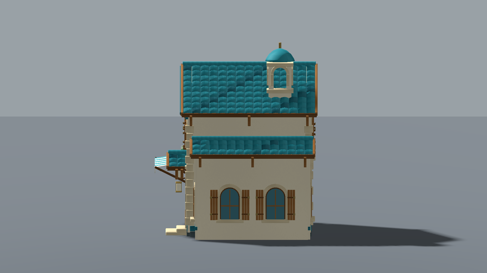
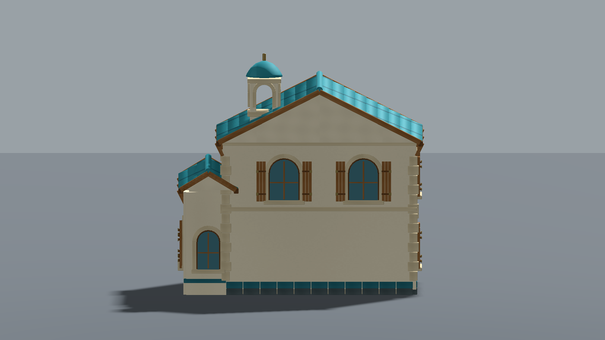
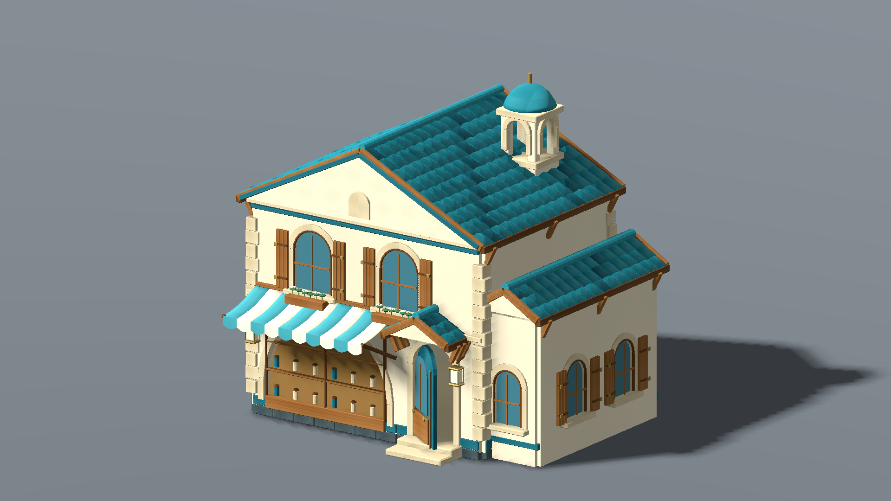

# Boutique Archélys — POC autonome Blender

[Télécharger le modèle Blender, le GLB, les scripts et les rendus](https://raw.githubusercontent.com/DyHyugal/pokemon-archelys/refs/heads/docs/cadrage-valide/docs/development/poc-boutique/POC-Boutique-Archelys-Blender.zip)

[Lire le bilan technique et artistique](BILAN.md)

Demande explicite du propriétaire dans « POC de génération 3D autonome avec Codex et Blender ». Test produit dans `/workspace/artifacts/archelys-poc-blender`, sans remplacer de fichier utilisé par le jeu, sans modifier scène/gameplay, sans fusion vers main. Seuls documents et pack de test sont publiés sur la branche de travail existante.

**Résultat :** boutique complète interprétée depuis la référence D001, 48 328 triangles, 23 meshes exportés, 14 matériaux utilisés et 9 textures originales intégrées. Source Blender rouverte et auditée ; GLB testé dans Godot 4.6.3 avec captures FHD. Trois itérations de géométrie, environ **31,12 minutes jusqu'au scellement du pack**, aucun service payant de génération 3D utilisé.

**Verdict :** alternative technique démontrée pour architecture régulière et composants. Le résultat reste un POC intermédiaire, de finition artistique insuffisante pour certifier la qualité du concept ou remplacer Tripo/Meshy sur toute l'île. Cette réserve porte sur la fidélité et la peinture des matériaux ; les images ci-dessous sont le vrai rendu moteur, pas des illustrations améliorées par IA.

L'archive contient aussi six rendus Blender, les vues face/caméra de jeu Godot, la référence, une comparaison HTML locale, textures PNG, scripts, logs, audits et empreintes. Décompresser puis ouvrir `Comparaison.html`, ou charger directement `boutique-archelys.blend`. Le `.blend` conserve les pièces éditables ; le GLB regroupe celles-ci par module. Les 23 meshes représentent 93 surfaces de matériaux et la scène de contrôle mesure 188 appels de dessin avec ses ombres/sol : pas un budget de ville entière validé.

Les 114 conditions Godot réussies contrôlent import/matériaux/modules/captures/porte ; elles ne certifient pas la qualité visuelle, un GPU Windows, des collisions ou le jeu complet. Aucun build Windows du jeu n'est créé par ce POC. Aucun choix final d'assets/moteur ni sélection Pokémon déduit.

Archive : 35 855 249 octets. SHA256 : `356eb93598dc96bf7c3cbc525a3164f76be853cab08c5d42ad34e0e58cbf9612`. Origines et empreintes détaillées dans [provenance.json](provenance.json).
