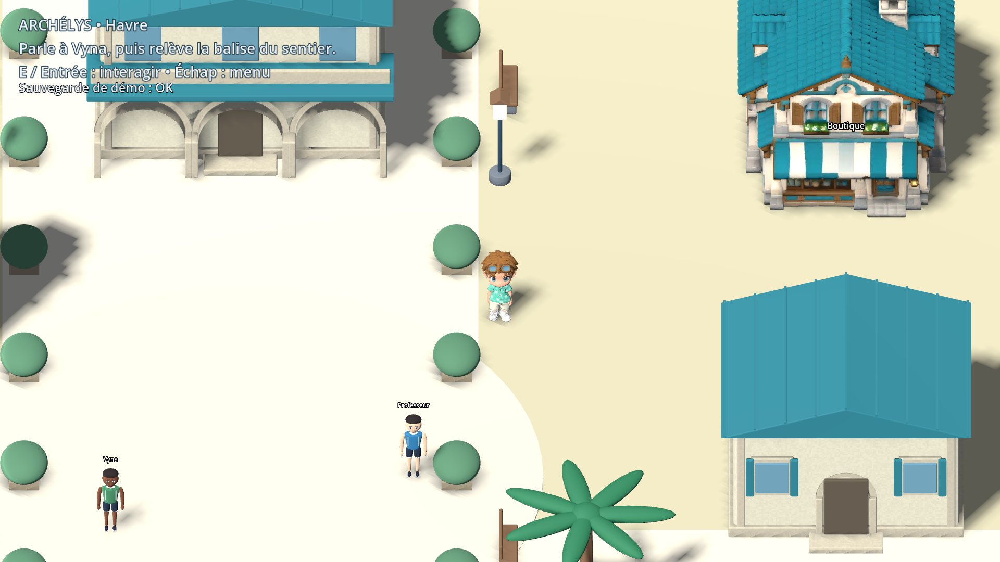
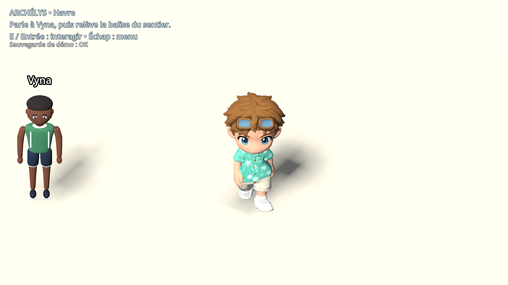
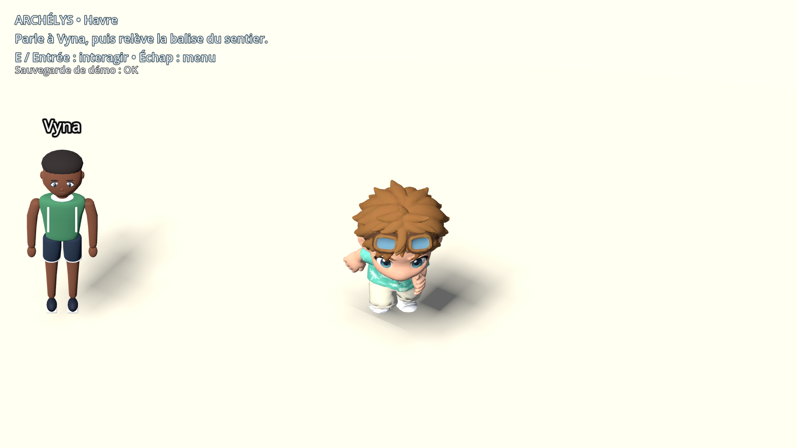
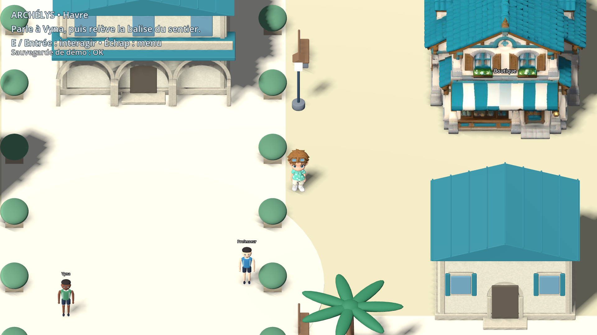

# Pilotes Tripo — captures réelles dans Godot

Captures de la démo en 1920×1080 après import des exports retopologisés et animés du propriétaire. Aucun montage ni remplacement du rendu par un concept. Carte/PNJ voisins encore en maquette. Validation visuelle owner en attente.

[Lot, sauvegardes, contrôles et limites](../LOT_TRIPO_PILOTES.md).

## D75 — boutique agrandie de 25 %

Collision et porte alignées, course +42 % et déplacement ×4 corrigé. Retour owner sur cet ajustement attendu.
